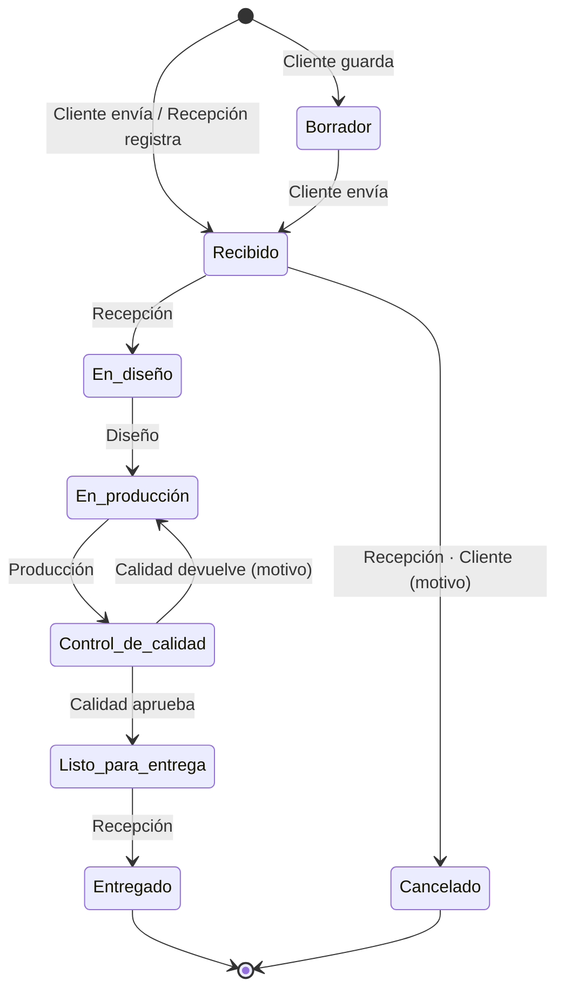

# Especificación · 003 · Flujo de producción por áreas

**Código:** FLU · **Estado:** Implementada · **Origen:** Retroactiva (v2) + contrato ejecutable · **Requisitos del documento original:** RF-15 a RF-21

## 1. Problema y objetivo
En la empresa "el pedido se pasa a diseño y después a producción, pero ese control nadie lo lleva". El objetivo específico 2 del proyecto es **crear estados de producción según el área donde está el pedido**. Esta spec define esos estados, quién puede mover el pedido en cada uno y qué queda registrado.

## 2. Historias de usuario
- **HU-FLU-01** · Como empleado de un área, quiero ver la bandeja de pedidos de mi etapa y tomar uno para que se sepa quién lo trabaja.
- **HU-FLU-02** · Como empleado de Calidad, quiero devolver un pedido a Producción explicando el motivo.
- **HU-FLU-03** · Como administrador, quiero ver quién movió cada pedido y cuándo.
- **HU-FLU-04** · Como empresa, quiero que nadie pueda saltarse etapas.

## 3. Flujo acordado (contrato: [`contracts/flujo_estados.json`](contracts/flujo_estados.json))

El administrador puede ejecutar cualquier transición del diagrama y además cancelar (con motivo) un pedido en cualquier estado activo.

## 4. Requisitos funcionales
- **RF-FLU-01** · El sistema debe permitir únicamente las transiciones del contrato `flujo_estados.json`; cualquier otra (saltar etapas, retroceder un pedido entregado, manipular el formulario) se rechaza en el servidor.
- **RF-FLU-02** · Cada etapa activa pertenece a un área (Recepción, Diseño, Producción, Calidad). Un empleado solo puede ver y mover pedidos cuya etapa actual sea de su área; solo Recepción y el administrador pueden cancelar.
- **RF-FLU-03** · Un empleado puede **tomar** un pedido de la bandeja de su área si no tiene responsable; si otro empleado es el responsable, nadie más del área puede moverlo.
- **RF-FLU-04** · Cuando el pedido pasa a una etapa de otra área, queda **sin responsable** en la bandeja de esa área.
- **RF-FLU-05** · Cancelar y devolver de Calidad a Producción exigen escribir un motivo (máx. 150 caracteres), que se guarda en el historial.
- **RF-FLU-06** · Cada cambio guarda en `historial_pedido` el usuario, el estado anterior, el estado nuevo, la descripción y la fecha, dentro de la misma transacción que el cambio.
- **RF-FLU-07** · Al pasar a Entregado se guarda la fecha real de entrega (`fecha_entregado`) para medir el cumplimiento.
- **RF-FLU-08** · Si dos personas cambian el mismo pedido a la vez, solo el primer cambio se aplica y el segundo recibe un aviso para recargar.

## 5. Criterios de aceptación
- **CA-FLU-01** (RF-FLU-01) Dado el código de `includes/pedidos.php`, cuando se compara con el contrato, entonces estados, áreas, transiciones y motivos coinciden exactamente. ⟶ Pruebas: S01, S03, S08
- **CA-FLU-02** (RF-FLU-01) Dado un pedido Recibido, cuando Recepción envía "Entregado" manipulando el formulario, entonces se rechaza. ⟶ Pruebas: F03
- **CA-FLU-03** (RF-FLU-01) Dado un pedido Entregado, cuando incluso el administrador intenta retrocederlo, entonces se rechaza. ⟶ Pruebas: F12
- **CA-FLU-04** (RF-FLU-01) Dado un pedido en Diseño, cuando avanza por Diseño, Producción y Calidad, entonces llega a Control de calidad. ⟶ Pruebas: F09
- **CA-FLU-05** (RF-FLU-02) Para cada estado y cada tipo de usuario, las acciones disponibles son exactamente las del contrato. ⟶ Pruebas: S02
- **CA-FLU-06** (RF-FLU-02) Dado un pedido en Recepción, cuando Diseño intenta avanzarlo, entonces se rechaza. ⟶ Pruebas: F02
- **CA-FLU-07** (RF-FLU-02) Dado un pedido nuevo en Recepción, cuando un empleado de Calidad intenta abrirlo, entonces se le niega el acceso. ⟶ Pruebas: F14
- **CA-FLU-08** (RF-FLU-03) Dado un pedido asignado a Diseño 1, cuando Diseño 2 intenta avanzarlo, entonces se rechaza. ⟶ Pruebas: F08, S02
- **CA-FLU-09** (RF-FLU-03, RF-FLU-04) Dado un pedido Recibido, cuando Recepción lo toma y lo envía a Diseño, entonces queda En diseño sin responsable. ⟶ Pruebas: F04
- **CA-FLU-10** (RF-FLU-05) Dado un pedido en Calidad, cuando se devuelve sin motivo se rechaza, y con motivo queda En producción. ⟶ Pruebas: F10
- **CA-FLU-11** (RF-FLU-06) Dado un cambio de estado, entonces el historial guarda usuario y estados anterior y nuevo. ⟶ Pruebas: F04, F13
- **CA-FLU-12** (RF-FLU-07) Dado un pedido Listo para entrega, cuando Recepción registra la entrega, entonces queda Entregado con la fecha real. ⟶ Pruebas: F11
- **CA-FLU-13** (RF-FLU-08) Dados dos usuarios con el mismo pedido abierto, cuando ambos lo avanzan, entonces el segundo recibe "Otra persona actualizó este pedido". ⟶ Verificación manual: abrir el pedido en dos navegadores con dos cuentas del área y pulsar el botón en ambos.

## 6. Fuera de alcance
- Flujos distintos por categoría de producto.
- Subetapas dentro de un área (por ejemplo, "corte" y "laminado" en Producción).
